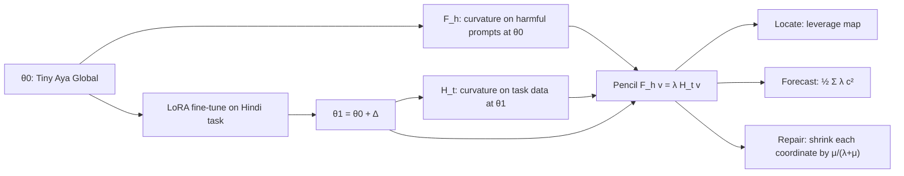

# Safety Pencil: the maths, step by step

Lexsi AI Safety Hackathon, Track 2b. Written 13 Nov 2026, after the scaled-repair run (job at commit f27e7eb). Numbers come from the result JSONs in the runs repo; the few that come only from the job's own report are marked *(job report)*.

**How to read this.** Parts 0–4 are the core idea and need only linear algebra. Parts 5–7 make it computable on a real 3-billion-parameter model. Part 8 is the leverage map. Parts 9–10 are what broke on 12 Nov and how it was fixed. Parts 11–13 compare against baselines and report the results. Part 14 is what we learned. A glossary of symbols is at the end.

---

## 0. What we are trying to achieve

### 0.1 The problem

Start with an aligned chat model, Tiny Aya Global. Call its weights $\theta_0$. It refuses most harmful requests.

Fine-tune it with LoRA on a harmless task: Hindi instructions from `aya_dataset`. The fine-tune changes the weights by an update $\Delta$, giving

$$\theta_1 = \theta_0 + \Delta .$$

No harmful data was involved, yet safety gets worse. On the test split, English harmful compliance (the Llama Guard 3 "unsafe" rate) went from **7% at $\theta_0$ to 22% at $\theta_1$** *(job report)*. This is the known "fine-tuning erodes alignment" effect, and we see it in a multilingual model fine-tuned on a non-English task.

### 0.2 The three questions

1. **Locate.** Which layers and modules carry the safety behaviour that the fine-tune damaged?
2. **Forecast.** Can we predict how much safety a given update $\Delta$ will cost, before running any evaluation?
3. **Repair.** Can we change $\Delta$ into a better update $\Delta'$ that removes the safety damage but keeps the task gain, cheaply and in closed form?

Every measurement is done separately in English, Hindi and Hinglish.

### 0.3 The one idea

Measure **two curvatures** of the same model:

- $F_h$: how sensitive the model's behaviour on **harmful prompts** is to each weight direction (curvature of the safety loss).
- $H_t$: how sensitive the **task loss** is to each weight direction (curvature of the task loss).

Then solve one **generalised eigenproblem**

$$F_h\, v = \lambda\, H_t\, v .$$

Each eigenvector $v$ is a weight direction, and its eigenvalue $\lambda$ is the ratio

$$\lambda = \frac{\text{safety damage along } v}{\text{task cost along } v}.$$

Large $\lambda$: moving along $v$ hurts safety a lot and barely matters to the task, so undo it. Small $\lambda$: the task needs it and safety doesn't care, so keep it. Locate, forecast and repair all fall out of this one basis.

### 0.4 The pipeline

### 0.5 What we claim, and what we don't

The repair is a member of the **Fisher-weighted merging** family (Fisher merging, RegMean, MaTS) and its objective overlaps AlignMerge. The forecast $\tfrac12\Delta^\top F_h \Delta$ is a known result (Springer et al., Prop. 3.3). We never call these new. What we test, to our knowledge for the first time:

- the generalised spectrum as a **leverage map** for locating safety;
- **exact invariance** of the computable repair under a symmetry of grouped-query attention, as a test that separates it from Euclidean "safety subspace" methods;
- a per-language forecast and repair on Tiny Aya.

---

## 1. Measuring safety drift: the KL and the Fisher $F_h$

### 1.1 Define drift

For a harmful prompt $x$, let $p_\theta(\cdot\mid x)$ be the model's next-token distribution. Drift is the KL divergence from the aligned model, averaged over harmful prompts and over the tokens of $\theta_0$'s own answers:

$$S(\theta) \;=\; \mathbb{E}_{x\sim D_h}\;\mathbb{E}_{y\sim p_{\theta_0}(\cdot\mid x)}\Big[\log p_{\theta_0}(y\mid x) - \log p_{\theta}(y\mid x)\Big] \;=\; \mathbb{E}_x\, \mathrm{KL}\big(p_{\theta_0}\,\|\,p_\theta\big).$$

In practice we generate $\theta_0$'s answers once, then score every model on exactly those answers, teacher-forced. That is why two models can be compared prompt by prompt later (Part 12).

Why KL rather than refusal rate? KL is smooth and differentiable in the weights, it needs no judge model, and it is defined per token. Refusal rate is a step function of the weights and needs a judge. We use KL to build the method and judged refusal and harmful compliance to evaluate it.

### 1.2 Why the second derivative of $S$ is the Fisher

$S(\theta_0) = 0$ and $S \ge 0$, so $\theta_0$ is a minimum. Expand around it with a weight update $\Delta$:

$$S(\theta_0 + \Delta) = S(\theta_0) + \nabla S^\top \Delta + \tfrac12 \Delta^\top \nabla^2 S\, \Delta + O(\|\Delta\|^3).$$

**Gradient.** $\nabla S(\theta) = -\mathbb{E}_x\mathbb{E}_{y\sim p_0}[\nabla \log p_\theta(y\mid x)]$. At $\theta = \theta_0$,

$$\mathbb{E}_{y\sim p_0}\big[\nabla\log p_0(y)\big] = \sum_y p_0(y)\,\frac{\nabla p_0(y)}{p_0(y)} = \nabla \sum_y p_0(y) = \nabla 1 = 0 .$$

**Hessian.** $\nabla^2 S = -\mathbb{E}_{p_0}[\nabla^2 \log p_\theta]$, and $\nabla^2 \log p = \dfrac{\nabla^2 p}{p} - \nabla \log p\,\nabla\log p^\top$. The first term averages to $\nabla^2 \sum_y p_0(y) = 0$ at $\theta_0$, so

$$\nabla^2 S\big|_{\theta_0} = \mathbb{E}_x\,\mathbb{E}_{y\sim p_0}\Big[\nabla\log p_0(y\mid x)\,\nabla\log p_0(y\mid x)^\top\Big] \;=:\; F_h .$$

That is the **Fisher information** on harmful prompts. Therefore, to second order,

$$\boxed{\,S(\theta_0+\Delta) \approx \tfrac12\, \Delta^\top F_h\, \Delta\,}$$

This is the **forecast**: given an update, predict drift without evaluating anything.

Note the labels: $y$ is sampled from the model $\theta_0$ itself, not taken from a dataset. That is the "true Fisher". Using dataset labels instead gives the "empirical Fisher", a different matrix that is not the Hessian.

### 1.3 The catch: "to second order"

The expansion is only valid while $\Delta$ is small. Part 13.5 measures drift along the straight line from $\theta_1$ back to $\theta_0$ and finds it scales like $(1-\alpha)^{0.72}$, not $(1-\alpha)^2$. The real fine-tune is far outside the quadratic regime. Note the direction, though: bending down to $t^{0.72}$ after a quadratic start would make the forecast too *high*, yet it is too *low*. So drift must grow faster than quadratic early on (confident tokens flipping: the exact KL is $\sinh(m_0)/m_0$ times its quadratic forecast for a reversed token with margin $m_0$), or K-FAC underestimates the curvature. `docs/WITH_MORE_CREDITS.md` (E1) separates the two.

---

## 2. Measuring task cost: the task Fisher $H_t$ and regret $R$

### 2.1 Task loss around $\theta_1$

Let $L_t(\theta) = -\mathbb{E}_{(x,y)\sim D_t}\log p_\theta(y\mid x)$ be the task loss (per-token NLL on Hindi task data). Expand around the fine-tuned weights with a step $\delta$:

$$L_t(\theta_1+\delta) = L_t(\theta_1) + g^\top\delta + \tfrac12\delta^\top H\,\delta + \dots,\qquad g = \nabla L_t(\theta_1).$$

If $\theta_1$ were a minimum of the task loss, $g = 0$, and the extra task loss caused by a step is the **regret**

$$R(\delta) = \tfrac12\,\delta^\top H_t\,\delta .$$

### 2.2 Which matrix is $H_t$

The exact Hessian $H$ can be indefinite and is expensive. We use the Fisher at $\theta_1$ with **labels sampled from the model**:

$$H_t = \mathbb{E}_{x\sim D_t}\,\mathbb{E}_{y\sim p_{\theta_1}(\cdot\mid x)}\big[\nabla\log p_{\theta_1}(y\mid x)\,\nabla\log p_{\theta_1}(y\mid x)^\top\big].$$

For a softmax output with cross-entropy loss this equals the generalised Gauss–Newton matrix $J^\top(\mathrm{diag}(p)-pp^\top)J$, so it is positive semidefinite, and it approximates the Hessian near a minimum. One backward pass of the sum of independently sampled log-probs gives an unbiased estimate of its factors (Part 5).

### 2.3 Null directions

$H_t$ is only positive **semi**definite. LayerNorm scales and the attention gauges (Part 7) create directions along which the network's function does not change at all. Both $F_h$ and $H_t$ are zero along them. Part 6 handles this.

### 2.4 The caveat we measured: $g \neq 0$

A fine-tune is not a minimum of the dev task loss. The code logs the diagnostic

$$\rho_g = \frac{|g^\top\delta|}{\tfrac12\,\delta^\top \hat H\,\delta}.$$

Above 0.1 the quadratic regret is not trustworthy. In the scaled sweep it was **0.72 to 14.4**, above 0.1 at every μ: the linear term dominates. Directly: moving from $\theta_1$ back toward $\theta_0$ along $-\Delta$ *improved* dev NLL, from 1.786 to 1.775 at 30% of the way back. A method that charges $\tfrac12\delta^\top H_t\delta$ for that move is charging for something that is actually free. So we never trust predicted regret; we measure task NLL.

---

## 3. The pencil: $F_h v = \lambda H_t v$

### 3.1 Two quadratic forms on one space

We now have two quadratic forms on weight space:

$$S(\Delta) = \tfrac12\,\Delta^\top F_h\,\Delta \quad(\text{safety}),\qquad R(\delta) = \tfrac12\,\delta^\top H_t\,\delta\quad(\text{task}).$$

A pair of symmetric matrices $(F_h, H_t)$ is called a **matrix pencil**. Its generalised eigenproblem is

$$F_h\,v = \lambda\,H_t\,v .$$

### 3.2 Simultaneous diagonalisation (assume $H_t \succ 0$ for now)

**Claim.** There is a matrix $V$ whose columns are eigenvectors, with

$$V^\top H_t V = I,\qquad V^\top F_h V = \Lambda = \mathrm{diag}(\lambda_1,\dots,\lambda_n),\quad \lambda_i \ge 0 .$$

**Construction.**

1. Cholesky-factor the task curvature: $H_t = LL^\top$.
2. Form the symmetric matrix $M = L^{-1}F_h L^{-\top}$.
3. Eigendecompose it: $M = Q\Lambda Q^\top$ with $Q$ orthogonal.
4. Set $V = L^{-\top}Q$.

**Check.** $V^\top H_t V = Q^\top L^{-1}LL^\top L^{-\top}Q = Q^\top Q = I$, and $V^\top F_h V = Q^\top L^{-1}F_hL^{-\top}Q = Q^\top M Q = \Lambda$.

### 3.3 What $\lambda$ means

For any direction $v$, the **Rayleigh quotient**

$$\lambda(v) = \frac{v^\top F_h v}{v^\top H_t v}$$

is safety damage per unit of task cost. The eigenvalues are its stationary values: $\lambda_{\max}$ is the direction that buys the most safety damage for the least task cost.

### 3.4 Coordinates

Because $V^\top H_t V = I$, the inverse is $V^{-1} = V^\top H_t$. Any update can be written in the pencil basis:

$$\Delta = V c,\qquad c = V^\top H_t\,\Delta .$$

In these coordinates both quadratic forms become sums of squares:

$$\Delta^\top F_h\Delta = c^\top\Lambda c = \sum_i \lambda_i c_i^2,\qquad \Delta^\top H_t\Delta = c^\top c = \sum_i c_i^2 .$$

### 3.5 The basis is not orthogonal in weight space

$V^\top H_t V = I$, but $V^\top V \neq I$ in general. The eigenvectors are orthogonal in the **task-curvature inner product** $\langle u,w\rangle_t = u^\top H_t w$, not in ordinary Euclidean distance. Two eigenvectors can point in almost the same weight-space direction. Part 9 shows this is exactly what broke the repair on the real model.

---

## 4. Forecast and repair in the pencil basis

### 4.1 Forecast

$$S(\theta_1) \approx \tfrac12\sum_i \lambda_i c_i^2 .$$

Each term is one direction's contribution, so the forecast also says *where* the drift is.

### 4.2 Repair as an optimisation

Choose a new update $\Delta'$ that balances safety against task regret, with an exchange rate $\mu > 0$:

$$J(\Delta') = \underbrace{\tfrac12\,\Delta'^\top F_h\,\Delta'}_{S:\ \text{drift from }\theta_0} \;+\; \mu\,\underbrace{\tfrac12\,(\Delta'-\Delta)^\top H_t\,(\Delta'-\Delta)}_{R:\ \text{regret relative to }\theta_1}.$$

Small $\mu$ means "care mostly about safety"; large $\mu$ means "keep the task". Set the gradient to zero:

$$F_h\Delta' + \mu H_t(\Delta'-\Delta) = 0 \;\Rightarrow\; \Delta' = (F_h+\mu H_t)^{-1}\mu H_t\,\Delta .$$

### 4.3 In coordinates it is one line

Write $\Delta' = Vz$. Multiply the stationarity condition by $V^\top$: $\Lambda z + \mu(z-c) = 0$, so each coordinate is solved on its own:

$$\boxed{\,z_i = \frac{\mu}{\lambda_i+\mu}\;c_i\,}$$

Every coordinate is shrunk by a factor between 0 and 1. If $\lambda_i \gg \mu$ the factor is near 0: that direction is removed. If $\lambda_i \ll \mu$ it is near 1: kept.

### 4.4 The frontier

Plug the solution back in:

$$S(\mu) = \tfrac12\sum_i \lambda_i\Big(\frac{\mu}{\lambda_i+\mu}\Big)^2 c_i^2,\qquad R(\mu) = \tfrac12\sum_i \Big(\frac{\lambda_i}{\lambda_i+\mu}\Big)^2 c_i^2 .$$

$S$ increases with $\mu$ and $R$ decreases. As $\mu\to 0$ every direction with $\lambda_i>0$ is removed (back to $\theta_0$); as $\mu\to\infty$ nothing is removed ($\theta_1$).

**Every point is Pareto-optimal within the quadratic model.** $\Delta'(\mu)$ minimises $S+\mu R$. If some $\Delta''$ had $S(\Delta'')\le S(\Delta')$ and $R(\Delta'')\le R(\Delta')$ with one strict, it would give a smaller $J$, a contradiction.

### 4.5 A two-dimensional worked example

Take $F_h = \mathrm{diag}(10,\,0.1)$, $H_t = I$, and $\Delta = (1,1)$. Then $\lambda = (10, 0.1)$, $c = \Delta$, and before repair $S_1 = \tfrac12(10 + 0.1) = 5.05$.

Repair at $\mu = 1$: $z = \big(\tfrac{1}{11},\ \tfrac{1}{1.1}\big) = (0.091,\ 0.909)$.

- $S = \tfrac12\,(10\cdot 0.091^2 + 0.1\cdot 0.909^2) = 0.083$
- $R = \tfrac12\,\big((1-0.091)^2 + (1-0.909)^2\big) = 0.417$

Compare plain interpolation (WiSE-FT), $\Delta' = t\Delta$: $S = 5.05\,t^2$ and $R = (1-t)^2$. Matching $R = 0.417$ needs $t = 0.354$, which gives $S = 0.633$. The pencil removes the high-$\lambda$ direction and keeps the low one, so at the same task cost its drift is **7.6× lower**. That is the advantage we hoped to see on the real model.

### 4.6 The same thing seen as a merge

$\theta_{\text{rep}} = \theta_0 + \Delta'$, and one line of algebra gives

$$\theta_{\text{rep}} = (F_h+\mu H_t)^{-1}\big(F_h\,\theta_0 + \mu H_t\,\theta_1\big).$$

(Check: $(F_h+\mu H_t)\theta_0 + \mu H_t\Delta = F_h\theta_0 + \mu H_t(\theta_0+\Delta)$.) This is a precision-weighted average of two models. That is why the repair belongs to the Fisher-merging family, and why the right baselines are other merges (Part 11).

---

## 5. Making it computable: K-FAC and Kronecker pencils

### 5.1 The size problem

Tiny Aya has about 3.3 billion weights. $F_h$ would be a $3.3\times10^9$ by $3.3\times10^9$ matrix. We need structure.

### 5.2 One linear layer

Take one linear module with weight $W$ of shape $d_{\text{out}}\times d_{\text{in}}$: output $s = Wa$. By the chain rule, the gradient of a log-probability with respect to $W$ is an outer product,

$$\nabla_W \log p = g\,a^\top,\qquad g = \frac{\partial\log p}{\partial s}.$$

Stack it as a vector: $\mathrm{vec}(g a^\top) = a\otimes g$. The Fisher block for this layer is

$$F = \mathbb{E}\big[(a\otimes g)(a\otimes g)^\top\big] = \mathbb{E}\big[aa^\top\otimes gg^\top\big] \;\approx\; \underbrace{\mathbb{E}[aa^\top]}_{A}\otimes\underbrace{\mathbb{E}[gg^\top]}_{G}.$$

That last step is the **K-FAC approximation**: it treats the input activations $a$ and the output gradients $g$ as independent. $A$ is $d_{\text{in}}\times d_{\text{in}}$ and $G$ is $d_{\text{out}}\times d_{\text{out}}$, so instead of one $(d_{\text{in}}d_{\text{out}})^2$ matrix we store two small ones (2048 and 11008 wide on Tiny Aya).

K-FAC drops two more things, and both matter for us:

- **Cross-layer blocks.** Each layer is treated separately (block-diagonal $F$).
- **Cross-position terms.** For a sequence, the gradient is $\sum_t g_t a_t^\top$. Its exact second moment contains terms $(a_t a_s^\top)\otimes(g_t g_s^\top)$ for $t\neq s$. "K-FAC expand" keeps only $t=s$. With a ~366-token chat preamble shared by every prompt, positions are strongly coupled, so this could be large. It is one candidate cause of the forecast being 24–39× too low.

Normalisation used: $A$ is a mean over the rows used, and $G$ is a sum over the same rows divided by the number of loss tokens.

### 5.3 Quadratic forms become traces

With column-stacking $\mathrm{vec}$ and symmetric $A$: $(A\otimes G)\,\mathrm{vec}(\Delta W) = \mathrm{vec}(G\,\Delta W A)$. Hence

$$\mathrm{vec}(\Delta W)^\top (A\otimes G)\,\mathrm{vec}(\Delta W) = \mathrm{tr}\big(G\,\Delta W\, A\,\Delta W^\top\big).$$

So per layer: $S = \tfrac12\mathrm{tr}(G_h\,\Delta W A_h\,\Delta W^\top)$ and $R = \tfrac12\mathrm{tr}(G_t\,\delta A_t\,\delta^\top)$.

### 5.4 Kronecker pencils split into two small pencils

Solve each side on its own:

$$A_h\,x = \alpha\,A_t\,x\quad(\text{input side}),\qquad G_h\,y = \gamma\,G_t\,y\quad(\text{output side}),$$

normalised so that $X^\top A_t X = I$ and $Y^\top G_t Y = I$. Then

$$(A_h\otimes G_h)(x\otimes y) = (A_hx)\otimes(G_hy) = \alpha\gamma\,(A_tx)\otimes(G_ty) = \alpha\gamma\,(A_t\otimes G_t)(x\otimes y).$$

So the full layer's eigenvectors are $x_i\otimes y_j$ and its eigenvalues are **products**

$$\lambda_{ij} = \alpha_i\,\gamma_j .$$

### 5.5 Coordinates, forecast and repair for one layer

Write $\Delta W = Y C X^\top$. The coordinate matrix is

$$C = Y^{-1}\Delta W X^{-\top} = Y^\top G_t\,\Delta W\,A_t X .$$

- Forecast: $S \approx \tfrac12\sum_{ij}\alpha_i\gamma_j\,C_{ji}^2$.
- Repair: shrink matrix $M_{ji} = \mu/(\alpha_i\gamma_j+\mu)$, new coordinates $M\circ C$ ($\circ$ = elementwise product).

We always apply it in **subtraction form**:

$$\Delta W' = \Delta W - Y\big((1-M)\circ C\big)X^\top .$$

Any part of $\Delta W$ outside the solved subspaces (null directions, truncated pairs) then passes through untouched. $\mu$ is the same for every layer.

### 5.6 A Tiny Aya detail

Tiny Aya uses a **parallel block**: attention and MLP read the same LayerNorm output. So q, k, v, gate and up projections share one input factor $A$ per layer.

---

## 6. Damping, range restriction, truncation and the ceiling

### 6.1 Covariant damping

$A_t$ and $G_t$ are only semidefinite, and Cholesky needs positive definite. Damp each task factor with a little of the **harm** factor, not with the identity:

$$A_t' = A_t + \gamma_c A_h,\qquad G_t' = G_t + \gamma_c G_h,\qquad \gamma_c = 10^{-3}.$$

**Effect on eigenvalues.** Suppose $A_hx = \alpha A_tx$. Then $A_tx = A_hx/\alpha$, so $(A_t+\gamma_cA_h)x = (1/\alpha+\gamma_c)A_hx$, and the damped eigenvalue is

$$\alpha' = \frac{\alpha}{1+\gamma_c\,\alpha} \;<\; \frac{1}{\gamma_c} = 1000 .$$

So every side eigenvalue is capped at $10^3$ and every product $\lambda_{ij}$ at $10^6$. The forecast $\tfrac12\Delta^\top F_h\Delta$ does not involve $H_t$ at all, so damping leaves it unchanged.

It is called **covariant** because $A_h$ transforms exactly like $A_t$ under a reparameterisation, so the damped pencil keeps the invariance of Part 7. Damping with $\nu I$ would break it.

### 6.2 The ceiling is also a free validity check

Each output eigenvalue is a Rayleigh quotient

$$\gamma = \frac{y^\top G_h y}{y^\top G_t y + \gamma_c\, y^\top G_h y}\;\le\;\frac{1}{\gamma_c}\quad\text{whenever } y^\top G_t y \ge 0 .$$

A true K-FAC factor is an average of outer products, so it is positive semidefinite and the bound must hold. If a solved eigenvalue exceeds $1/\gamma_c$, the stored factor has gone **numerically indefinite** (fp32 accumulation from a bf16 model). Of 252 modules, exactly two broke the ceiling on 12 Nov: layer 35 gate_proj ($\gamma = 1.4\times10^3$) and up_proj ($\gamma = 2.2\times10^3$). They are among the three modules with the largest repair steps (L35 down_proj also stepped 63×, but its step on task inputs was tiny; Part 9).

### 6.3 Range restriction and known null vectors

Each side is solved on the range of $A_h + A_t$ (eigenvalues above $10^{-10}\times$ max). Two null vectors are known exactly and projected out: the shared q/k/v/gate/up input factor has the null vector $1/w$ (the LayerNorm has no bias), and the o_proj and down_proj output factors have the all-ones vector (every path to the loss passes a mean-subtracting LayerNorm).

### 6.4 Truncation

On MLP-width sides (11008) only the top $k = 512$ pairs are solved. Pairs outside pass through unchanged. The extra drift this leaves is at most $\tfrac12\,\alpha_{\max}\gamma_{(k+1)}\,\|C_{\text{discarded}}\|^2$, so truncate only where $\alpha_{\max}\gamma_{(k+1)} \ll \mu$.

### 6.5 Jitter

If a Cholesky fails, retry with $\varepsilon\cdot\mathrm{mean}(\mathrm{diag})$ added, for $\varepsilon \in \{10^{-10}, 10^{-8}, 10^{-6}, 10^{-4}\}$. On 12 Nov two sides needed more than the default: layer 0 down_proj input ($10^{-4}$) and layer 35 up_proj output ($10^{-8}$).

---

## 7. Invariance under the GQA V/O gauge (P1)

### 7.1 The symmetry

Tiny Aya uses grouped-query attention: 16 query heads share 4 key/value heads (query head $h$ reads KV head $\lfloor h/4\rfloor$), head dimension 128. In one KV group, the value projection computes $v_s = W_v x_s$ at each position $s$, attention mixes positions linearly with weights $a_{ts}$, and the output projection maps back: $o_t = W_o \sum_s a_{ts} v_s$.

Pick any invertible $128\times128$ matrix $M$ for that group, and change the weights to

$$W_v \to M\,W_v,\qquad W_o \to W_o\,\bar M^{-1},$$

where $\bar M$ applies $M^{-1}$ on the slices of the four query heads that read this group. Then

$$W_o\bar M^{-1}\sum_s a_{ts}\,M W_v x_s = W_o\sum_s a_{ts}\,W_v x_s .$$

The function is **identical**; the weights are different. Any method that is really about the function should give the same answer in both coordinate systems. (This needs v_proj to have no bias and no norm; checked for Tiny Aya.)

### 7.2 How the factors and the update transform

- v_proj: its output becomes $Ms$, so output gradients become $M^{-\top}g$ and $G_v \to M^{-\top}G_vM^{-1}$; its input factor is unchanged; $\Delta W_v \to M\Delta W_v$.
- o_proj: its input becomes $\bar M a$, so $A_o \to \bar M A_o\bar M^\top$; its output factor is unchanged; $\Delta W_o \to \Delta W_o\bar M^{-1}$.

### 7.3 The pencil repair is exactly invariant

Take v_proj's output side. The transformed pencil $M^{-\top}G_hM^{-1}\,y' = \gamma\,M^{-\top}G_tM^{-1}\,y'$ is solved by $y' = My$ with the **same** $\gamma$. The normalisation survives: $(MY)^\top M^{-\top}G_tM^{-1}(MY) = Y^\top G_tY = I$. The coordinates survive:

$$C' = (MY)^\top\big(M^{-\top}G_tM^{-1}\big)(M\Delta W)A_tX = Y^\top G_t\,\Delta W\,A_tX = C .$$

Same coordinates, same eigenvalues, same shrink, so the repaired update is $M\Delta W'$ and the repaired **function** is the same. Covariant damping $G_t + \gamma_cG_h$ transforms the same way, so it is safe. o_proj's input side works the same way with $\bar M$.

### 7.4 Why Euclidean methods fail it

A method that projects $\Delta W$ onto a "safety subspace" with ordinary orthogonal projections, or damps with $\nu I$, uses the Euclidean inner product, which changes under $M$. Its repaired function depends on which of the equivalent weight settings you started from.

**Measured (P1, condition number 10):** the covariant pencil, RegMean and ReSta are invariant to float precision (max $|\Delta\log p| \approx 2\times10^{-3}$, KL $\approx 10^{-9}$). The Euclidean pencil, diagonal Fisher, an AlignMerge-style transform and Safe LoRA are not (max $|\Delta\log p|$ from $6\times10^{-2}$ to $1.1$). On 13 Nov the scaled pencil (Part 10) was as invariant as the covariant one: KL $8.2\times10^{-10}$ at condition 10 and $1.75\times10^{-9}$ at condition 30.

---

## 8. Locating safety: the leverage map (P5)

For each module, the **leverage** is its largest pencil eigenvalue $\lambda_{\max} = \alpha_{\max}\gamma_{\max}$ (also the sum of its top ten). High leverage means there is some direction in that module where safety is very sensitive and the task barely cares.

Pooled over languages, the median per-module maximum is $6.7\times10^3$ for k_proj, $1.1\times10^4$ for o_proj, $1.4\times10^4$ for down_proj, $1.7\times10^4$ for v_proj, $2.3\times10^4$ for q_proj, $1.4\times10^5$ for gate_proj and $1.4\times10^5$ for up_proj. The single largest is layer 35 up_proj at $8.2\times10^5$, and layer 35 tops most module types. Late MLP blocks dominate, as P5 predicted.

Two caveats. Many of these values sit near the covariant ceiling ($10^6$ for a product), and layer 35's gate and up output factors broke it, so the very top of the map is partly numerical. The refusal-direction cosine and the CircuitKIT comparison were not run.

---

## 9. What went wrong on 12 Nov: oblique projections

### 9.1 What happened

The covariant repair was run on run A for $\mu \in \{0.003, 0.01, 0.03, 0.1, 0.3, 1\}$. At every $\mu$:

- measured drift went from 0.24 to about **31**, and task NLL from 1.79 to about **31**;
- the largest per-module step was **94×** the size of the fine-tune itself ($\|\Delta W'-\Delta W\|_F/\|\Delta W\|_F$, layer 35 up_proj);
- the model's own prediction was drift $\approx 0.003$.

The trust-region check (rule 11) rejected every point, as designed.

### 9.2 Why the result barely depends on $\mu$

The measured eigenvalues split into a **plateau** ($10^3$ to $10^6$) and a **bulk** below 0.003. For every $\mu$ in the grid, $\lambda \gg \mu$ on the plateau and $\lambda \ll \mu$ in the bulk, so the shrink factors are almost exactly 0 or 1. The repair is then close to a fixed map:

$$\Delta' \approx V\,\mathrm{diag}(\mathbb{1}_{\text{bulk}})\,V^{-1}\,\Delta .$$

### 9.3 That map is an oblique projector

Write $P = VDV^{-1}$ with $D$ a 0/1 diagonal. Then $P^2 = VD^2V^{-1} = P$, so $P$ is a projector: onto the kept subspace $K = \mathrm{span}(V_{\text{bulk}})$, along the removed subspace $U = \mathrm{span}(V_{\text{plateau}})$. Because $V$ is not orthogonal (Part 3.5), $P$ is not symmetric. It is an **oblique** projector, and the step is $\delta = \Delta'-\Delta \approx -P_U\Delta$.

**How big can an oblique projection be?** Take a unit vector $\Delta = u + k$ with $u\in U$, $k\in K$, where the lines $U$ and $K$ meet at angle $\theta$. By the sine rule in the triangle formed by $\Delta$, $u$ and $k$,

$$\|u\| = \frac{\sin\angle(\Delta, K)}{\sin\theta} \;\le\; \frac{1}{\sin\theta}.$$

In general, $\|P_U\| = 1/\sin\theta_{\min}$, where $\theta_{\min}$ is the smallest angle between the two subspaces. The two parts $u$ and $k$ are huge and cancel each other. Delete $u$ and only the huge $k$ is left.

A step ratio of 94 means $\sin\theta_{\min}\le 1/94$, so **$\theta_{\min}\le 0.61°$**. In layer 35 up_proj, a direction the repair removes and a direction it keeps are less than a degree apart in weight space.

### 9.4 Why the method's own metric never complained

Define the curvature norm $\|U\|_t^2 = \mathrm{tr}(G'UA'U^\top)$. Then $\|\Delta W\|_t^2 = \|C\|_F^2$ exactly, and the repair multiplies coordinates by numbers in $[0,1]$, so

$$\|\delta\|_t = \|(1-M)\circ C\|_F \le \|C\|_F = \|\Delta W\|_t .$$

In the metric the method believes in, the step is **never** larger than the fine-tune. But in weight space,

$$\frac{\|\delta\|_F}{\|\Delta W\|_F} \;\le\; \kappa_2(Y)\,\kappa_2(X) = \sqrt{\kappa(G')\,\kappa(A')}\,,$$

since $Y^\top G'Y = I$ forces the singular values of $Y$ to be $1/\sqrt{\mathrm{eig}(G')}$. With near-singular or indefinite factors this bound is effectively unlimited. And the quadratic model has no information about what such a step does: along those directions the factors are at the noise level.

### 9.5 Which modules broke the model

Weight-space size alone is not the problem. A step only damages the model if it changes the activations the model actually sees. The input-weighted ratio $\|\delta A^{1/2}\|_F/\|\Delta W A^{1/2}\|_F$ counts that, because $\mathbb{E}\|\delta a\|^2 = \mathrm{tr}(\delta A\delta^\top)$. (The 12 Nov run computed it with $A_t'$ instead of $A_t$; corrected in the log.) At $\mu = 1$:

| Module | Input-weighted ratio > 1 | Median | Max |
|---|---|---|---|
| q_proj | 29 / 36 | 1.32 | 14.4 (L0) |
| k_proj | 8 / 36 | 0.69 | 2.4 (L2) |
| up_proj | 1 / 36 | 0.44 | 62.0 (L35) |
| gate_proj | 1 / 36 | 0.28 | 45.4 (L35) |
| v_proj | 0 / 36 | 0.44 | 0.8 |
| o_proj | 0 / 36 | 0.29 | 0.4 (Euclidean up to 12) |
| down_proj | 0 / 36 | 0.06 | 0.1 (Euclidean up to 63) |

down_proj and o_proj take huge weight-space steps along input directions the task never visits, so they are harmless. The model is broken by output-side steps in q, k and layer 35's gate and up, the two modules whose factors broke the ceiling.

---

## 10. The fix: output-side damping plus a trust region

The goal was a fix that bounds every step, keeps exact V/O invariance, and **cannot manufacture an advantage**.

### 10.1 Trust region by scaling

Compute the repair, then scale each module's step back if it is too big:

$$\delta_k \leftarrow t_k\,\delta_k,\qquad t_k = \min(1,\,1/r_k),\qquad r_k = \frac{\|\delta_k A_t^{1/2}\|_F}{\|\Delta W_k A_t^{1/2}\|_F}.$$

In pencil coordinates a coordinate becomes $c\mapsto(1-t(1-M))\,c$. Then

$$S(t) = \tfrac12\sum\lambda\,\big(1-t(1-M)\big)^2c^2,\qquad \frac{dS}{dt} = -\sum\lambda\,(1-M)\,\big(1-t(1-M)\big)\,c^2 \;\le\; 0,$$

because $1-M\in[0,1]$ and $t\in[0,1]$. And since $R$ is quadratic in the step, $R(t) = t^2R(1)$. So scaling slides each module along a straight line from $\theta_1$ toward its full repair: within the quadratic model, drift falls monotonically and regret rises as $t^2$. The scaled step satisfies rule 11 by construction.

**Why this cannot create a win.** Scaling only ever shrinks steps. If the repair's advantage is real, its steps are already inside the trust region and nothing changes. If the advantage came from an oversized step, scaling removes it. In the two-dimensional toys on the explainer page ("Pencil Repair Stability"), the best drift at task regret $\le 0.02$ was:

| Toy | WiSE-FT | Exact pencil | Pencil + trust region |
|---|---|---|---|
| Real advantage | 0.640 | 0.183 | 0.183 (cap never binds) |
| Artefact (copies 12 Nov) | 0.640 | no valid point (steps up to 29×) | 0.595 |

### 10.2 Output-side damping is a step penalty

Add $\nu I$ to the output-side task factor only, $G'' = G' + \nu I$. The task term becomes

$$\tfrac12\,\mathrm{tr}\big((G'+\nu I)\,\delta A'\delta^\top\big) = R(\delta) + \frac{\nu}{2}\,\|\delta A'^{1/2}\|_F^2 .$$

So it is the same pencil (same closed form) with an extra penalty on the input-weighted step, which conditions the solve so the trust region rarely has to cut much. In a plateau output direction where task curvature is about zero, the eigenvalue becomes

$$\gamma'' = \frac{g_h}{\gamma_c g_h + \nu} = \frac{1}{\gamma_c}\cdot\frac{1}{1+\nu/(\gamma_c g_h)} .$$

Strong harm directions ($\gamma_c g_h\gg\nu$) keep their leverage; noise-level ones ($\gamma_c g_h\ll\nu$) stop being removed. We used $\nu = 10^{-2}\times\mathrm{mean}(\mathrm{diag}\,G')$, the middle value of rule 11's pre-registered grid, run once with no selection.

### 10.3 Invariance is kept

The V/O gauge touches only v_proj's output factor and o_proj's input factor (Part 7.2). So v_proj gets $\nu = 0$ and no scaling: its step is already a contraction in its gauge-invariant curvature norm (Part 9.4). o_proj's ratio uses $\mathrm{tr}(\delta A_t\delta^\top)$, which is unchanged when $\delta$ and $A_t$ transform together. Every other module's factors are untouched by the gauge.

### 10.4 Fixed before measuring

The $\mu$ grid was placed where predicted regret $\sum_k t_k(\mu)^2R_k(\mu)$ falls to $\{0.01, 0.02, 0.05, 0.1, 0.2, 0.4\}$ of its value at $\mu=0$, written to the result file before any measurement. The finalist rule ($\mu^*$ = smallest accepted $\mu$ with dev task NLL $\le 1.786 + 0.1\times(2.138-1.786) = 1.821$) and a backup rule were also fixed in advance.

---

## 11. Baselines: one objective, four curvature models

All the merges we compare minimise the same kind of objective, "stay close to $\theta_0$ on harmful inputs and close to $\theta_1$ on task inputs". They differ only in the curvature model.

| Method | Curvature model | What it does |
|---|---|---|
| WiSE-FT | $F_h = \kappa H_t$ (all $\lambda$ equal) | $\theta_0 + (1-\alpha)\Delta$: shrinks every direction equally |
| RegMean | $G_h = G_t = I$ (input side only) | $W_1 - \Delta W A_h(A_h+\mu A_t)^{-1}$ |
| Diagonal Fisher | each matrix replaced by its diagonal | per-weight shrink $\mu f_t/(f_h+\mu f_t)$ |
| Pencil | full Kronecker on both sides | shrink $\mu/(\alpha_i\gamma_j+\mu)$ in an oblique basis |

**WiSE-FT as a pencil.** If $F_h = \kappa H_t$, then $J$'s stationarity gives $(\kappa+\mu)H_t\Delta' = \mu H_t\Delta$, so $\Delta' = \frac{\mu}{\kappa+\mu}\Delta$: uniform shrinkage. Its step ratio is $\alpha \le 1$ in every norm.

**RegMean as a pencil.** RegMean minimises

$$\mathrm{tr}\big((W-W_0)A_h(W-W_0)^\top\big) + \mu\,\mathrm{tr}\big((W-W_1)A_t(W-W_1)^\top\big).$$

That is the pencil objective with both output factors set to $I$, so $\gamma_j\equiv1$ and $\lambda_{ij} = \alpha_i$. Solving gives $W = W_1 - \Delta W A_h(A_h+\mu A_t)^{-1}$; along an input eigendirection the removed fraction is $\alpha/(\alpha+\mu)$. If the stored $A_t$ is slightly indefinite, some $\alpha<0$ and $\alpha+\mu = 0$ at $\mu = -\alpha$: a **pole**. That is why RegMean blew up at $\mu\approx 509$ (S 1.22, NLL 2.63). Its settings near the pencil's task NLL ($\mu\le4.5$) are far from the poles.

**Diagonal Fisher as a pencil.** Replace each Fisher by its diagonal. The basis becomes the standard basis, which is orthonormal, and each weight is shrunk by a factor in $[0,1]$, so the step can never exceed $\Delta$ in any norm. It is not V/O invariant (Part 7.4).

This table is the cleanest way to read the results: **the pencil uses the most detailed curvature model**, and that extra detail is all in the output-side eigenbasis.

---

## 12. Statistics: how we decide

### 12.1 Proportions: Wilson interval

For $k$ successes out of $n$, $\hat p = k/n$ and $z = 1.96$:

$$\frac{\hat p + \frac{z^2}{2n} \pm z\sqrt{\frac{\hat p(1-\hat p)}{n}+\frac{z^2}{4n^2}}}{1+\frac{z^2}{n}} .$$

Unlike $\hat p\pm z\sqrt{\hat p(1-\hat p)/n}$, it stays inside $[0,1]$ and behaves well near 0% or 100%.

### 12.2 Paired prompts: exact McNemar

Two models answer the same prompts. Only discordant prompts carry information: $b$ = safe under A and unsafe under B, $c$ = the reverse. Under "no difference", $b \sim \mathrm{Binomial}(b+c,\ \tfrac12)$; the two-sided exact p-value comes from that binomial.

### 12.3 Three languages: Holm correction

Sort the $m$ p-values $p_{(1)}\le\dots\le p_{(m)}$. Reject $p_{(1)}$ if $p_{(1)}\le\alpha/m$, then $p_{(2)}$ if $p_{(2)}\le\alpha/(m-1)$, and so on, stopping at the first failure. It controls the chance of any false positive across the three languages.

### 12.4 Drift differences: paired bootstrap

Drift is a token-weighted mean, $S = \sum_i \mathrm{kl}_i / \sum_i n_i$ over prompts $i$. To compare two models on the same prompts, resample prompts with replacement, recompute both $S$ values on the same resample, and take the difference; 2000 resamples give a percentile 95% interval. When all 2000 land on one side, report $p < 1/2000$, not $p = 0$.

### 12.5 Comparing at equal task cost

A repair can always lower drift by giving up task performance, so methods must be compared **at matched dev task NLL**. Two rules:

- **Pre-registered closest-NLL:** pick each baseline's setting whose NLL is closest to the pencil's $\mu^*$.
- **Frontier (post-hoc, labelled):** pick each baseline's lowest-drift setting with NLL no worse than the pencil's $+0.005$.

They disagree when a baseline's NLL is **flat** near the target. WiSE-FT's dev NLL was 1.783, 1.780, 1.777, 1.775, 1.775, 1.776 for $\alpha$ = 0.05 to 0.5, so many settings sit within 0.005 of the target while their drift ranges from 0.233 to 0.154. Closest-NLL picked $\alpha=0.1$ (drift 0.223), an almost arbitrary point that flatters the pencil. That is why the frontier comparison is the headline and the pre-registered one is always shown beside it, never alone.

---

## 13. Results and what they mean

### 13.1 Before repair

| | en | hi | Hinglish |
|---|---|---|---|
| Dev drift $S(\theta_1)$ | 0.261 | 0.222 | 0.243 |
| Forecast $\tfrac12\Delta^\top F_h\Delta$ | 0.0068 | 0.0075 | 0.0100 |

Dev task NLL: $\theta_0$ 2.138, $\theta_1$ 1.786.

The drift row comes from the L40S sweep. The L4 drift job (`drift_S`) gave 0.262 / 0.218 / 0.238 for the same checkpoint, because bf16 rounding differs by GPU. The P2 ratios use those values; both give 24–39×.

### 13.2 P2, forecast: fails

Spearman correlation between forecast and measured refusal drop across checkpoint–language pairs: $\rho = 0.17$, 95% CI $[-0.17,\ 0.49]$, $n = 36$. The forecast is 24–39× too low on run A's final checkpoint (24–111× across all 36 checkpoint–language pairs) and orders the languages wrongly (it puts Hinglish first; measured drift puts English first).

### 13.3 P1, invariance: holds

See Part 7.4. This is the cleanest positive result.

### 13.4 P3, the scaled repair sweep: valid at every $\mu$

| $\mu$ | Predicted $R/R(0)$ | Dev $S$ (en / hi / Hinglish) | Task NLL | Max Euclidean ratio | $\rho_g$ | Rule 11 |
|---|---|---|---|---|---|---|
| $\theta_1$ | — | 0.242 (0.261 / 0.222 / 0.243) | 1.786 | — | — | — |
| 5.21 | 0.01 | 0.208 (0.223 / 0.196 / 0.203) | 1.784 | 61.8 | 14.4 | pass |
| 1.56 | 0.02 | 0.202 (0.218 / 0.192 / 0.197) | 1.784 | 63.2 | 0.72 | pass |
| 0.280 | 0.05 | 0.195 (0.212 / 0.187 / 0.188) | 1.782 | 63.8 | 7.0 | pass |
| 0.0607 | 0.1 | 0.191 (0.208 / 0.183 / 0.183) | 1.782 | 63.9 | 6.7 | pass |
| 0.0105 | 0.2 | 0.188 (0.203 / 0.180 / 0.179) | 1.781 | 63.9 | 5.9 | pass |
| 0.0019 | 0.4 | 0.185 (0.200 / 0.178 / 0.176) | 1.780 | 64.0 | 4.7 | pass |

The fix did its job: no blow-up, drift falls in every language, task NLL does not rise. But it removes only **24%** of the drift at $\mu^* = 0.0019$, while its own model predicted drift $\approx 0.003$. The grid stopped at NLL 1.780, well short of the 1.821 limit, because predicted regret ignores the $g^\top\delta$ term.

### 13.5 WiSE-FT and the drift law

Along WiSE-FT, $\theta_0 + (1-\alpha)\Delta$, measured drift relative to $\theta_1$:

| $1-\alpha$ | 0.95 | 0.9 | 0.8 | 0.7 | 0.6 | 0.5 | 0.25 |
|---|---|---|---|---|---|---|---|
| Measured $S(\alpha)/S(\theta_1)$ | 0.962 | 0.924 | 0.85 | 0.778 | 0.708 | 0.636 | 0.354 |
| Quadratic model $(1-\alpha)^2$ | 0.902 | 0.81 | 0.64 | 0.49 | 0.36 | 0.25 | 0.062 |

Fitting $S(\alpha)/S(\theta_1) = (1-\alpha)^p$ gives $p = 0.72$, 95% CI $[0.71, 0.74]$ (en 0.71, hi 0.70, Hinglish 0.77). The quadratic model says $p = 2$. Halving the update removes only 36% of the drift, not 75%.

This shows the **forecast** is applied outside its regime. The exponent alone does not say why the forecast is too *low* (bending below $t^2$ would make it too high); the likely cause is confident tokens flipping, where the exact KL is $\sinh(m_0)/m_0$ times its quadratic (`docs/WITH_MORE_CREDITS.md`, E1). The post-repair prediction of 0.003 is about 60× too low. It does **not** by itself explain why the pencil loses P6, because diagonal Fisher is also a quadratic model and it wins (13.6).

### 13.6 P6, repair against baselines: fails on dev

Lowest-drift dev settings within the frontier tolerance (task NLL $\le$ 1.785):

| Method | Dev $S$ | Task NLL |
|---|---|---|
| RegMean, $\mu = 0.3$ | 0.148 | 1.783 |
| WiSE-FT, $\alpha = 0.5$ | 0.154 | 1.776 |
| Diagonal Fisher, $\mu = 1.35$ | 0.158 | 1.777 |
| Scaled pencil, $\mu^* = 0.0019$ | 0.185 | 1.780 |

Paired bootstrap, $S(\text{pencil}) - S(\text{baseline})$: between +0.023 and +0.039 in every language against every baseline, all intervals above zero, Holm $p < 1/2000$. Under the pre-registered closest-NLL rule the pencil beats only WiSE-FT's flat-NLL pick ($\alpha = 0.1$) and still loses to RegMean and diagonal Fisher in all three languages.

Further along the task range, inside the 1.821 limit, diagonal Fisher reaches $S = 0.060$ at NLL 1.803 ($\mu = 0.27$), and $S = 0.0016$ at NLL 1.868 just outside it ($\mu = 0.12$): 99% of the drift removed while keeping 77% of the task gain. So the drift and the task gain **are** separable weight by weight. The pencil's construction fails to exploit that.

### 13.7 Test tier: real repair, ties RegMean *(job report)*

- **Pencil $\mu^*$:** English harmful compliance falls from 22% back to 7%, $\theta_0$'s level (Holm $p\approx10^{-14}$). Hinglish compliance was not changed by the fine-tune and does not change. Task NLL and English MMLU are kept (MMLU 59% → 61%). English over-refusal falls from 55% to 32% ($\theta_0$: 14%).
- **RegMean (matched, $\mu = 1.16$):** harmful compliance indistinguishable from the pencil in every language (paired McNemar n.s.); English over-refusal 24%.
- **WiSE-FT α = 0.5** (post-hoc frontier match): harmful compliance 5.4% / 4.9% / 21.4%, English over-refusal 15.5% (pencil 31.5%, Holm p ≈ 10⁻⁸), task NLL 1.771. It matches it on harmful compliance and Hinglish refusal and halves its English over-refusal; its English refusal is further from θ0 (67.0% vs 62.5%; θ0 59.8%) and English MMLU is lower (58.5% vs 61.0%).

Removing only 24% of the KL drift was enough to reverse English harmful compliance fully. **KL drift is a blunt proxy for judged behaviour.** On KL the pencil is clearly behind RegMean; on judged harmful compliance they tie.

---

## 14. Honest takeaways and open questions

### What holds

- The closed-form repair, its frontier and its merge interpretation (Parts 3–4) are exact for the quadratic model.
- **Exact invariance** under the V/O gauge holds on the real model, for both the covariant and the scaled pencil, and separates curvature-based merges from Euclidean ones.
- The bounded (scaled) pencil is a **valid repair**: it never breaks the model, and on test it restores English harmful compliance to $\theta_0$'s level while keeping the task gain.

### What fails

- **Forecasts.** Drift scales like $(1-\alpha)^{0.72}$ along the fine-tune, outside the second-order regime, and second-order forecasts made at $\theta_0$ are far too low at $\theta_1$ (P2 fails); confident tokens flipping is the likely reason.
- **The full two-sided pencil is numerically fragile.** Unbounded, it blows up through near-parallel oblique directions, exactly in the modules whose fp32 factors broke the $1/\gamma_c$ ceiling. Bounded, it is valid but removes only 24% of the measured drift, and the trust region is not what limits it: scaling holds back about 0.6% of the predicted removal.
- **P6 fails on dev KL.** RegMean (input side only), diagonal Fisher (diagonals only) and plain WiSE-FT all leave less drift at equal task cost. The extra ingredient the pencil adds, the output-side eigenbasis, is where the trouble is. On judged harmful compliance it ties RegMean.

### Open questions

1. Is the output side the culprit? Testing it would mean an input-only pencil (RegMean) against the full pencil with fp64 factors and a larger factor sample.
2. Do factors that keep cross-position terms (K-FAC-reduce, EK-FAC) fix the forecast gap?
3. At the 90%-task-gain limit (NLL 1.821) the pencil was never measured, because its grid stopped at 1.780. A mini-extension would settle it; given that its drift moved only from 0.208 to 0.185 across three decades of $\mu$, it is unlikely to catch diagonal Fisher.
4. Why does diagonal Fisher work so well here? It uses $\mathrm{diag}(G)\,\mathrm{diag}(A)^\top$ from the same K-FAC factors as the pencil (confirmed), so the information for a selective repair is in the same factors, and the full generalised eigensolve is what loses it.

---

## Appendix: symbol glossary

| Symbol | Meaning |
|---|---|
| $\theta_0$, $\theta_1$ | aligned model; fine-tuned model |
| $\Delta$, $\Delta W$ | fine-tune update (whole model; one layer) |
| $\Delta'$, $\Delta W'$ | repaired update |
| $\delta = \Delta'-\Delta$ | repair step |
| $S$ | safety drift: KL from $\theta_0$ on harmful prompts |
| $R$ | task regret: extra task loss relative to $\theta_1$ |
| $F_h$ | Fisher (curvature) of $S$ at $\theta_0$ |
| $H_t$ | task Fisher at $\theta_1$, sampled labels |
| $\lambda$, $V$, $c$ | pencil eigenvalues, eigenvectors, coordinates |
| $\mu$ | exchange rate between safety and task |
| $A$, $G$ | K-FAC input and output factors ($h$ harm, $t$ task) |
| $\alpha$, $\gamma$; $X$, $Y$ | side eigenvalues; side eigenvectors |
| $C$, $M$ | coordinate matrix; shrink matrix $\mu/(\alpha_i\gamma_j+\mu)$ |
| $\gamma_c$ | covariant damping, $10^{-3}$ |
| $\nu$ | output-side damping, $10^{-2}\times\mathrm{mean\,diag}(G')$ |
| $r_k$, $t_k$ | input-weighted step ratio; trust-region scale $\min(1,1/r_k)$ |
| $\rho_g$ | $|g^\top\delta|/(\tfrac12\delta^\top\hat H\delta)$, first-order check |
| $p$ | drift exponent along WiSE-FT, $S\propto(1-\alpha)^p$ |
