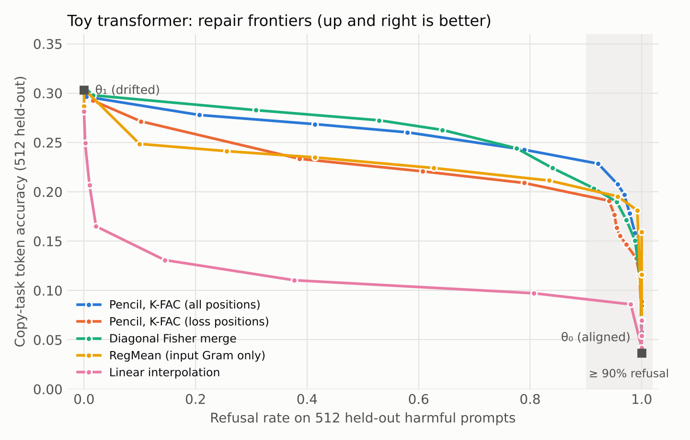

# Verifying the Safety Pencil maths

Checked on 6 Nov 2026. This note goes through every claim the method relies on: what was checked, how, the numbers, and what had to change. All of it can be re-run on a laptop CPU:

| Script | What it checks | Time |
| --- | --- | --- |
| `tests/test_math.py` | 18 identities on random matrices (numpy) | under 1 s |
| `verify_toy_transformer.py` | The maths on a real transformer, against exact curvature (writes `verify_results.json`) | about 25 min |
| `baselines_toy.py` | The pencil against interpolation, diagonal Fisher merging and RegMean (writes `baselines_results.json`) | about 5 min |
| `plot_frontier.py` | Draws `frontier.png` from `baselines_results.json` | seconds |

You need numpy, scipy, matplotlib and `jax[cpu]`. Maths is in GitHub LaTeX, with section numbers (§) referring to `PROOFS.md`.

---

## Verdict

1. **The algebra is right.** On a transformer with Tiny Aya's relevant features, these hold to machine precision ($10^{-14}$ to $10^{-16}$):
   - the Hessian of the safety loss is the sampled-label Fisher;
   - the Gauss–Newton matrix is the task Fisher;
   - the V/O gauge preserves the function and transforms the K-FAC factors as predicted;
   - the K-FAC repair is exactly invariant under that gauge, while a Safe-LoRA-style projection is not.

   Two more were checked differently. The frontier slope $-\mu$ agrees to 0.6% by finite differences on the network's quadratic model. The Kronecker repair equals the full-matrix solution in the unit tests, on random matrices.
2. **It is implementable, but not exactly as first written, and the quadratic model is only qualitatively right at realistic scale.** Following the plan to the letter, the exact full-matrix repair makes things *worse* in the toy: safety drift rises from 0.61 to 1.27 nats and the task gain disappears. What we know:
   - **Only Euclidean damping (a trust region) fixed the exact repair,** and it breaks exact invariance. Covariant damping did not help.
   - **The K-FAC repair, which is what we will run, did not blow up** with covariant damping. It restored refusal while keeping most of the task gain. We have not established why, so a trust-region check is mandatory.
   - **Even with damping, the quadratic model's numbers are off at full scale.** The predicted drift after repair is 28–885× smaller than the actual drift. So forecasts and the predicted frontier are ranking tools, not calibrated predictions.
   - **Four changes go into the code** (§3 below): range restriction plus the subtraction form, covariant damping, a trust-region check, and measured rather than predicted task regret.
3. **The repair step is Fisher-weighted model merging.** When $F_h + \mu H_t$ is invertible, $\theta_0 + \Delta_{\text{rep}} = (F_h + \mu H_t)^{-1}(F_h\theta_0 + \mu H_t\theta_1)$; §4 gives the form with null directions. As an algorithm, it is therefore not new: see Matena & Raffel 2022, RegMean and MaTS. What remains ours (§4 below):
   - the choice of weight on $\theta_0$: the Hessian of the KL on harmful prompts;
   - the eigen-analysis: locate, forecast, a frontier with slope $-\mu$, and a truncation bound;
   - the gauge-invariance result;
   - the multilingual study.
4. **How it fares.** On the toy, every curvature-weighted merge beats plain interpolation by a wide margin. Among the merges there is no reliable winner (§5 below):
   - the pencil is highest between about 80% and 96% refusal;
   - RegMean is highest from 97% refusal up, the safety-critical end;
   - the gaps are 0.01–0.05 accuracy, about the size of the evaluation noise.

   So:
   - RegMean and diagonal Fisher merging must be baselines in P6;
   - the write-up should lead with the analysis and the invariance result, not with "a better repair".

---

## 1. How the checks were done

There are three layers.

1. **On paper.** Every proof in `PROOFS.md` was re-derived line by line. The new lemmas are proved in §3 and §4 below.
2. **Unit tests.** `test_math.py` checks each identity on random positive-definite matrices, in numpy, at `np.allclose`'s default tolerance (relative $10^{-5}$). Two limit tests use an absolute $10^{-3}$ or $10^{-4}$.
3. **On a network.** `verify_toy_transformer.py` runs in JAX at float64.
   - **Architecture.** The toy copies the Tiny Aya features the maths depends on:
     - grouped-query attention, with 4 query heads sharing 2 KV heads (query head $h$ reads KV head $h // 2$);
     - a parallel attention + MLP block reading a single mean-subtracting LayerNorm with no affine terms;
     - a gated SiLU MLP;
     - causal masking.
   - **Size.** Vocabulary 40, width 16, 2 layers, 10 tokens per sequence (6 prompt tokens, 4 response tokens). Only the 14 linear modules are trained, like LoRA targets: 3840 parameters.
   - **Exact expectations.** Every expectation over next tokens is computed exactly by enumerating the vocabulary. So identities are tested to machine precision, and approximations are measured against the exact answer rather than a noisy estimate.
   - **$\theta_0$ ("aligned").** Trained to answer 64 harmful prompts with a fixed 4-token refusal, and to do a copy task.
   - **$\theta_1$ (benign fine-tune).** 300 Adam steps on the copy task only. Held-out refusal falls from 1.00 to 0.00, and copy accuracy rises from 0.04 to 0.30. This is the kind of drift the method is meant to repair.

**Caveat.** A 3840-parameter toy proves the algebra and exposes failure modes. It does not predict effect sizes on a 3.35B-parameter model.

---

## 2. Every claim, checked

Each row starts with an ID: V-numbers come from `verify_toy_transformer.py`, and B is the baseline comparison. "Fails" means the claim, as originally written, does not hold; §3 gives the fix.

| ID | Claim | Source | Result | Status |
| --- | --- | --- | --- | --- |
| V1 | The Hessian of $S$ at $\theta_0$ is the sampled-label Fisher $F_h$ | Lemma 2.1 | relative error $4.5\times10^{-16}$; $\lVert\nabla S(\theta_0)\rVert = 3.5\times10^{-17}$ | Pass |
| V2 | The GGN equals the model Fisher on task data | Lemma 3.1 | relative error $5.5\times10^{-16}$ | Pass |
| V3 | Dropping the GGN residual term is harmless at $\theta_1$ | §3 | the full Hessian differs from the GGN by 104% and has an eigenvalue of −66.8 | **Fails:** $\theta_1$ is not a task minimum |
| V3b | Small damping makes $H_t$ positive definite | A2 | 472 of the 3840 directions are exactly null for both $F_h$ and $H_t$ | **Fails:** needs range restriction (§3.1) |
| V4 | $S(\theta_1) \approx \tfrac12\Delta^\top F_h\Delta$ | Prop. 1 | ratio of actual to forecast: 2.98, 1.50, 1.13, 1.04, 1.01 at update scales 1, 0.3, 0.1, 0.03, 0.01 | Pass as a Taylor statement; the forecast is 3× too low at full scale |
| V5 | $S$ and task regret after repair match the prediction | Prop. 2 | at scale 0.01 and undamped: the *reduction* in $S$ is right to 1.9% of the starting drift, but the residual $S$ is 840× too small and the step is 6.3× the update. Regret matches (3.5%) only with the full Hessian plus the gradient term. With Euclidean damping, both match to 2% | **Fails undamped;** passes with Euclidean damping |
| V5b | The exact repair works at realistic scale | Prop. 2 | undamped: $S$ goes from 0.61 to 1.27 and task loss rises by 1.22. Euclidean damping at 0.01: $S$ falls to 0.29 and task loss falls by 0.014 | **Fails without a trust region** (§3.2–3.3) |
| V6 | $dS/dR = -\mu$ | Prop. 5.2 | finite-difference slope −0.303 against $-\bar\mu = -0.305$, on the quadratic model | Pass |
| V7 | One backward pass of summed sampled labels gives an unbiased $G$ | Lemma 3.6 below | error 0.185, 0.054, 0.022 at $10^2$, $10^3$, $10^4$ samples, shrinking like $1/\sqrt n$ | Pass |
| V8 | A K-FAC block approximates the exact Fisher block | §8 | median per-entry error 0.80 (loss positions) to 0.90 (all positions) | **Poor entry by entry** |
| V8b | The K-FAC quadratic form is right on the actual update | §8 | median ratio 1.02 (loss) and 1.12 (all); range 0.57–2.10 and 0.64–4.01 across modules | Good in aggregate, noisy per module |
| V9 | The K-FAC forecast matches the exact forecast | P2 | 0.205 (all) and 0.216 (loss) against an exact 0.205; actual $S$ is 0.611 | Pass |
| V9b,c | The K-FAC repair restores refusal | P6 | with covariant damping $10^{-3}$ at $\mu = 0.03$: refusal from 0 to 0.95 (loss rows) and 0.98 (all rows), keeping copy accuracy of 0.16 and 0.21 (64 held-out prompts, so a standard error of about 0.03). Across all 8 factor × damping settings at $\mu = 0.03$: refusal 0.94–0.98, accuracy 0.16–0.23. Refusal falls and accuracy rises with $\mu$ in all 8 | Pass |
| V10a | The V/O gauge leaves the function unchanged | §9 | maximum logit change $1.1\times10^{-14}$ | Pass |
| V10b | The K-FAC factors transform by one-sided congruence | Prop. 9.1 | errors $1.4\times10^{-14}$ and $2.4\times10^{-16}$ | Pass |
| V10c | The K-FAC repair is invariant | Prop. 9.1 | $1.6\times10^{-14}$ with covariant damping, $2.1\times10^{-14}$ with none, but **0.033 with Euclidean damping**. Logits are compared on the factor sequences | Pass, except with Euclidean damping |
| V10d | A Safe-LoRA-style projection is not invariant | Prop. 4 | maximum logit change 5.95 | Pass |
| V10e | ReSta is invariant (the positive control) | Prop. 4 | $1.6\times10^{-14}$ | Pass |
| V11a | Covariant damping keeps the eigenvectors and maps $\lambda \to \lambda/(1+\gamma\lambda)$ | Lemma 3.2 below | exact | Pass |
| V11b | The P-quad LoRA penalty equals the Kronecker quadratic form | Prompt 7 | 126.784 = 126.784 | Pass |
| B | The pencil against simpler and prior merges | P6 | highest at 80–96% refusal; RegMean highest at 97% and above; gaps of 0.01–0.05, within noise | Competitive, not dominant (§5) |

Two consistency checks fall out of V8:
- **Where "expand" is exact.** It is exact ($4\times10^{-16}$) for every last-layer module whose output at position $\tau$ reaches only position $\tau$: `q`, `o`, `gate`, `up` and `down`. It is not exact for the last layer's `k` and `v`, whose outputs feed later positions through attention. So there are no cross-position terms to drop exactly when a module's output stays at its own position.
- **Covariant damping at large $\mu$.** At update scale 0.1 and $\mu = 3$, covariant damping shrinks the exact repair's step from 5.19 to 4.0 times the update norm. Lemma 3.2 (iii) predicts $1/1.3$ of the undamped step at $\mu = 2.3$. That matches only because the undamped step length barely changes with $\mu$ (5.189 at 0.3, 5.194 at 3).

---

## 3. What had to change, with proofs

### 3.1 Null directions: restrict to the range, write the result in subtraction form

**The problem.** Assumption A2 says a little damping makes $H_t$ positive definite. With covariant damping or no damping it does not. In the toy, 472 directions are exactly null for both $F_h$ and $H_t$, and Tiny Aya will have such directions too. Two sources:

- **LayerNorm.** Cohere's LayerNorm subtracts the mean and has no bias (Prompt 0 checks this), so every input $a$ to `q`, `k`, `v`, `gate` and `up` satisfies $(1/w)^\top a = 0$, where $w$ is the LayerNorm weight. So $W \mapsto W + b\,(1/w)^\top$ changes no output for any input. The $A$ factor of these layers has the exact null vector $1/w$.
- **Continuous symmetries.** The V/O and Q/K gauges are null directions of the *full* Fisher at first order. They couple two layers, so they are not null directions of the per-layer K-FAC factors.
- **Finite data.** A factor estimated from too few rows can be rank-deficient.

For the K-FAC factors, LayerNorm is what made the Cholesky factorisation of $A_t$ fail in the first run.

**Lemma 3.1.** For positive semidefinite $F$ and $H$, $\operatorname{null}(F) \cap \operatorname{null}(H) = \operatorname{null}(F + H)$. Let $\mathcal R = \operatorname{range}(F + H)$. Then:
- $J(\delta) = \tfrac12(\Delta+\delta)^\top F(\Delta+\delta) + \tfrac\mu2\,\delta^\top H\delta$ does not depend on the component of $\delta$ outside $\mathcal R$;
- for every $\mu > 0$, $F + \mu H$ is positive definite on $\mathcal R$;
- the minimiser with $\delta \in \mathcal R$ is unique.

*Proof.*
- $v^\top(F+H)v = 0$ if and only if $v^\top Fv = v^\top Hv = 0$. For positive semidefinite matrices, that holds if and only if $Fv = Hv = 0$.
- If $\delta = \delta_{\mathcal R} + n$ with $n$ in that common null space, every term of $J$ is unchanged.
- On $\mathcal R$, $F + \mu H \succeq \min(1, \mu)(F + H) \succ 0$. ∎

**Implementation.** For each factor pair $(A_h, A_t)$, and likewise for $(G_h, G_t)$:
1. Take an orthonormal basis $U$ of $\operatorname{range}(A_h + A_t)$, keeping eigenvalues above $10^{-10}$ of the maximum.
2. Solve the pencil for $U^\top A_h U$ and $U^\top A_t' U$, where $A_t'$ is the damped task factor.
3. Set $X = U X_r$.
4. Write the repaired update in **subtraction form**: $\Delta W' = \Delta W - Y\big((1 - M)\circ C\big)X^\top$.

The correction lies in the range, so any component of $\Delta W$ along an exact null direction passes through untouched. Adam's elementwise scaling can put such components into a LoRA update. `test_range_restricted_repair_matches_full_matrix_and_keeps_null_part` checks that this equals the full-matrix minimiser on the range.

**One subtlety.** Invariance is now *functional*. Two parameterisations give repaired layers with identical outputs on every input in $\operatorname{range}(A_h + A_t)$ (above the $10^{-10}$ cutoff), while the raw weights may differ along the null directions. A reviewer measured raw-weight differences of 0.05–2.3 alongside output agreement to $10^{-12}$.
- For LayerNorm nulls this covers every input the model can produce, because every LayerNorm output lies in that range.
- For nulls that come from finite data, held-out inputs can leave the range, and outputs can then differ. V10c compared logits on the factor sequences only.
- On Tiny Aya, check invariance on held-out prompts too.

### 3.2 Damping: three kinds, three different jobs

| Damping | Formula | What it does | Invariant? |
| --- | --- | --- | --- |
| None | $H_t$ | Factor by factor, it works only when $\operatorname{null}(A_t) \subseteq \operatorname{null}(A_h)$; otherwise $U^\top A_t U$ is singular. A reviewer's random trials crashed half the time. The step can be several times the update. **Not supported** | Yes |
| Covariant | $H_t + \gamma F_h$ (per factor: $A_t + \gamma A_h$, $G_t + \gamma G_h$) | Caps every $\lambda$ at $1/\gamma$. The step is the undamped step at $\mu/(1+\mu\gamma)$, scaled by $1/(1+\mu\gamma)$. A trust region only in the $F_h$ norm | **Yes** |
| Euclidean | $H_t + \bar\gamma I$, with $\bar\gamma = \gamma \cdot \text{mean diag}$ | Acts as a trust region: bounds the step | **No** (0.033 logit change in V10c) |

**Lemma 3.2 (covariant damping).** Let $H' = H + \gamma F$. Then:
- (i) the generalised eigenvectors are unchanged and $\lambda' = \lambda/(1+\gamma\lambda)$;
- (ii) the forecast $\tfrac12\sum\lambda' c'^2 = \tfrac12\Delta^\top F\Delta$ is unchanged;
- (iii) the repair step is $\delta'(\mu) = \dfrac{1}{1+\mu\gamma}\,\delta\Big(\dfrac{\mu}{1+\mu\gamma}\Big)$, where $\delta(\cdot)$ is the undamped step.

*Proof.*
- (i) If $Fv = \lambda Hv$, then $H'v = Hv + \gamma\lambda Hv = (1+\gamma\lambda)Hv$, so $Fv = \tfrac{\lambda}{1+\gamma\lambda}H'v$.
- (ii) Normalising in $H'$ gives $v' = v/\sqrt{1+\gamma\lambda}$ and $c' = v'^\top H'\Delta = \sqrt{1+\gamma\lambda}\,c$, so $\lambda' c'^2 = \lambda c^2$.
- (iii) The stationarity condition is $F(\Delta+\delta') + \mu(H + \gamma F)\delta' = 0$, that is $\big((1+\mu\gamma)F + \mu H\big)\delta' = -F\Delta$. Divide by $1+\mu\gamma$ and compare with the undamped equation at $\tilde\mu = \mu/(1+\mu\gamma)$. ∎

So covariant damping is harmless and keeps invariance, but it is not a Euclidean trust region. In pencil coordinates it shrinks coordinate $i$ by $(\lambda_i+\mu)/(\lambda_i+\mu+\mu\gamma\lambda_i)$, which depends on $\lambda_i$. So the Euclidean step can even grow slightly; a reviewer found up to 1.11× in random 3-D trials. At small $\mu\gamma$ it barely changes the step, which is why it did not rescue the exact repair (V5b).

**The tension, stated precisely.** The blow-up happens along directions that are nearly null for *both* $F_h$ and $H_t$. Any damping built from $F_h$ and $H_t$ alone sees nothing there, so it cannot bound those steps. A bound needs a metric from outside the pair, such as $I$, and that metric is not reparameterisation-invariant. So exact invariance and a Euclidean trust region are incompatible by construction. We keep invariance in the method, and use the Euclidean trust region only as a checked fallback.

### 3.3 Why the undamped exact repair fails, and the trust region that fixes it

**Lemma 3.3 (step size).**
- $\lVert\delta^\star\rVert_{H_t} \le \lVert\Delta\rVert_{H_t}$;
- $\lVert\Delta + \delta^\star\rVert_{F_h} \le \lVert\Delta\rVert_{F_h}$;
- but $\lVert\delta^\star\rVert_2 / \lVert\Delta\rVert_2$ is bounded only by the condition number of $V$, and can be arbitrarily large.

*Proof.* In pencil coordinates, $\delta^\star = -V\,\mathrm{diag}\big(\tfrac{\lambda}{\lambda+\mu}\big)c$.
- $\lVert\delta^\star\rVert_H^2 = \sum(\tfrac{\lambda}{\lambda+\mu})^2c^2 \le \sum c^2 = \lVert\Delta\rVert_H^2$.
- In the same way, $\lVert\Delta+\delta^\star\rVert_F^2 = \sum\lambda(\tfrac{\mu}{\lambda+\mu})^2c^2 \le \sum\lambda c^2$.
- In the Euclidean norm, $\lVert\delta^\star\rVert_2 \le \sigma_{\max}(V)\lVert c\rVert$ and $\lVert\Delta\rVert_2 \ge \sigma_{\min}(V)\lVert c\rVert$.
- To see that the ratio is unbounded, take $H = \mathrm{diag}(1, \eta^2)$, $F = aa^\top$ with $a = (1, \eta)$, and $\Delta = e_1$. Then $\lVert\delta^\star\rVert_2/\lVert\Delta\rVert_2 \approx 1/((2+\mu)\eta) \to \infty$ as $\eta \to 0$. Checked: 4.37, 43.5 and 435 at $\eta = 10^{-1}, 10^{-2}, 10^{-3}$, with $\mu = 0.3$. ∎

**What this means.** The repair trusts the quadratic model most exactly where the curvature is nearly flat. When $H_t$ is ill-conditioned on $\mathcal R$, it writes $\Delta$ as large components that cancel, shrinks them by different amounts, and so produces a step much longer than $\Delta$:
- 6.3 times the update even at scale 0.01;
- 2.4 times at full scale.

A step that long leaves the region where the Taylor expansion holds; V4 already shows $S$ at 3 times the quadratic at full scale. `test_step_is_bounded_in_curvature_norms_but_not_euclidean` reproduces this on random matrices.

**The fix: a trust region.** Adding $\tfrac{\mu\bar\gamma}{2}\lVert\delta\rVert_2^2$ to $J$, which is Euclidean damping, is the Lagrangian form of the constraint $\lVert\delta\rVert_2 \le r(\bar\gamma)$ (Levenberg–Marquardt; Moré & Sorensen 1983). The radius $r$ shrinks as $\bar\gamma$ grows. In K-FAC, Euclidean damping is applied to each factor, so the added term is $\bar\gamma_G A_t\otimes I + \bar\gamma_A I\otimes G_t + \bar\gamma_A\bar\gamma_G I$ rather than $\bar\gamma I$, and this reading is only approximate there. At small scale, the damped second-order model becomes accurate:

| Exact repair, update scale 0.01, $\mu = 0.03$ | Step / update | $S$ after, actual | $S$ after, predicted | Regret, actual | Regret, predicted (with gradient) |
| --- | --- | --- | --- | --- | --- |
| No damping | 6.26 | $3.1\times10^{-7}$ | $3.7\times10^{-10}$ | $8.1\times10^{-4}$ | $7.8\times10^{-4}$ |
| Euclidean, $\gamma = 0.01$ | 0.52 | $1.93\times10^{-8}$ | $1.90\times10^{-8}$ | $1.043\times10^{-4}$ | $1.043\times10^{-4}$ |

At full scale with Euclidean damping $\gamma = 0.01$:
- $\mu = 0.03$: $S$ falls from 0.611 to 0.167 (−73%) and task loss rises by 0.043;
- $\mu = 0.3$: $S$ falls to 0.287 (−53%) and task loss *falls* by 0.014.

The direction is right, but the size is not. Across all six damped full-scale rows, the predicted $S$ after repair is 28–885× smaller than the actual value (for example $8.8\times10^{-4}$ predicted against 0.287 actual). At realistic scale, treat the quadratic model's predictions as rankings, not numbers.

**The K-FAC repair behaves better than the exact one.** With covariant damping at $10^{-3}$, it restores refusal from 0 to 0.98 at $\mu = 0.03$, with no blow-up (V9c). The Kronecker structure ties each module's curvature to two small factors and drops cross-module coupling, which seems to remove the long, thin valleys of the exact matrix. We have no proof that this always holds, so the trust-region check in §3.5 is mandatory.

### 3.4 Task regret needs the gradient term

**The problem.** Proposition 1's second line, $L_t(\theta_0) - L_t(\theta_1) \approx \tfrac12\Delta^\top H_t\Delta$, and the predicted $R(\mu)$ both assume $\nabla L_t(\theta_1) = 0$. A LoRA fine-tune stopped after a fixed number of steps is not at a minimum, and neither is the toy's $\theta_1$ (V3). The second-order regret of a correction $\delta$ is

$$R(\delta) \approx g^\top\delta + \tfrac12\,\delta^\top \nabla^2 L_t\,\delta, \qquad g = \nabla L_t(\theta_1).$$

In the table above, the GGN-only prediction ($6.5\times10^{-7}$) is 160 times too small, while the gradient-aware one (full Hessian plus gradient) agrees to 0.05%.

**The rule.**
- **Use** the Fisher for the repair itself. It is positive semidefinite, which keeps the problem convex, and it is the merge weight (§4).
- **Measure** task regret on dev data. Do not plot the predicted $R(\mu)$ as data.
- **Report** the diagnostic $|g^\top\delta| \,/\, \tfrac12\delta^\top\hat H\delta$. As a rule of thumb (not derived), above 0.1 the predicted $R$ axis is not trustworthy.
- **Do not** add $\mu g$ to the repair equation (the "gradient-corrected step" $-(F+\mu H)^{-1}(F\Delta + \mu g)$). We tried it, and it blows up along the near-null directions of $F + \mu H$.

### 3.5 K-FAC normalisation and the one-pass estimator

**Lemma 3.5 (K-FAC-expand normalisation; a derivation of the approximation, not a bound on its error).** The per-token Fisher of a linear layer is $F = \frac1N\sum_s \mathbb E_y[\nabla_W\ell_s\nabla_W\ell_s^\top]$, with $\nabla_W\ell_s = \sum_\tau g_{s,\tau}a_\tau^\top$ summed over positions $\tau$, and $N$ the number of loss tokens. Drop the cross-position terms ($\tau \ne \tau'$; Eschenhagen et al. 2023), then factorise. This gives $F \approx A \otimes G$ with

$$A = \frac{1}{|\mathcal T|}\sum_{\tau\in\mathcal T} a_\tau a_\tau^\top, \qquad G = \frac{1}{N}\sum_{\tau\in\mathcal T}\sum_s \mathbb E\big[g_{s,\tau}g_{s,\tau}^\top\big],$$

where $\mathcal T$ is the set of rows (positions) used.

*Proof.* $\sum_\tau a_\tau a_\tau^\top \otimes \hat G_\tau \approx \big(\tfrac{1}{|\mathcal T|}\sum_\tau a_\tau a_\tau^\top\big) \otimes \big(\sum_\tau \hat G_\tau\big)$, because $\sum_\tau X_\tau \otimes Y_\tau = \bar X \otimes \sum_\tau Y_\tau + |\mathcal T|\,\mathrm{Cov}_\tau(X, Y)$ with $\bar X$ the row mean. The factorisation drops the covariance term, so it is exact when $a_\tau a_\tau^\top$ and $\hat G_\tau$ do not co-vary across rows (for instance when either is the same on every row). Dividing by $N$ gives the stated $A$ and $G$. When $\mathcal T$ is restricted to loss positions, the diagonal terms $\tau = \tau'$ for $\tau \notin \mathcal T$ are dropped too. That is a further approximation, not covered here. ∎

So: **$A$ is a mean over the rows used; $G$ is a sum over the same rows divided by the number of loss tokens.** In V9 this normalisation gives forecasts within 6% of exact (0.205 and 0.216 against 0.205).

**Lemma 3.6 (one backward pass is enough).** Sample $\tilde y_s \sim p_\theta(\cdot\mid c_s)$ independently at every loss position, keeping the teacher-forced prefixes, and back-propagate $\tilde L = \sum_s \log p(\tilde y_s\mid c_s)$ once. Then the outer product of the output gradient at each position $\tau$ is unbiased for $\sum_s \mathbb E[g_{s,\tau}g_{s,\tau}^\top]$.

*Proof.*
- Cross terms with $s \ne s'$ factorise, $\mathbb E[g_{s,\tau}g_{s',\tau}^\top] = \mathbb E[g_{s,\tau}]\,\mathbb E[g_{s',\tau}]^\top$, because the prefix is fixed, so $\tilde y_s$ never feeds into $c_{s'}$.
- Each factor is zero, because $\mathbb E_{y\sim p}[\nabla\log p(y)] = 0$. ∎

V7 confirms this numerically.

**Which rows to use.** In the toy:
- **Loss-position rows** are more accurate entry by entry: error 0.80 against 0.90, and quadratic-form ratio 1.02 against 1.12.
- **All-position rows** give the better repair frontier (§5).

So accumulate both sets of $A$ and $G$ in the same pass and choose on dev.

### 3.6 Other corrections and additions

- **Truncation bound (Lemma 8.3).** If only the top-$k$ output-side pairs are repaired, the extra safety drift is at most $\tfrac12\,\varepsilon\,\min(1, 2\varepsilon/\mu)\,\lVert C_{K^c}\rVert_F^2$, where $\varepsilon = \alpha_{\max}\gamma_{k+1}$.
  - *Proof:* each discarded term is $\tfrac12\lambda C_{ji}^2\big[1 - (\tfrac{\mu}{\lambda+\mu})^2\big]$ with $\lambda = \alpha_i\gamma_j \le \varepsilon$, and $1 - (\tfrac{\mu}{\lambda+\mu})^2 = \tfrac{\lambda(\lambda+2\mu)}{(\lambda+\mu)^2} \le \min(1, 2\lambda/\mu)$. ∎
  - So when $\varepsilon \ll \mu$ the extra drift is of order $\varepsilon^2/\mu$, and truncation is safe.
  - Tested in `test_truncation_error_bound`.
- **Per-head leverage is a lower bound.** For any block $b$ of coordinates (one head's slice of `o_proj`) with $H_{bb} \succ 0$, $\lambda_1(F_{bb}, H_{bb}) \le \lambda_1(F, H)$.
  - *Proof:* Courant–Fischer, maximising the Rayleigh quotient over a subspace.
  - So per-head maps never overstate a layer's leverage.
  - Tested in `test_per_head_leverage_is_a_lower_bound`.
- **Proposition 3 holds for full-parameter fine-tuning only.** With LoRA, "preserve" minimises over low-rank updates, which is a constrained problem, so expect a gap even in the quadratic regime.
- **The repaired update has full rank.** $(1-M)\circ C$ destroys the low-rank structure. Ship repaired checkpoints as merged weights, not as LoRA adapters of the original rank.
- **Eigenvalue-corrected pencil.** Keep the K-FAC basis $(X, Y)$ and re-estimate each $\lambda_{ji}$ as $\mathbb E_h[(y_j^\top \nabla W\, x_i)^2] \,/\, \mathbb E_t[(y_j^\top \nabla W\, x_i)^2]$ from per-token gradients. On the toy it changed little: refusal 0.20 against 0.17 at $\mu = 0.3$. This is an optional extra.

---

## 4. The repair is Fisher-weighted merging: what that means for novelty

**Proposition 4.1.** If $F_h + \mu H_t$ is invertible, $\theta_0 + \Delta_{\text{rep}} = (F_h + \mu H_t)^{-1}\,(F_h\,\theta_0 + \mu H_t\,\theta_1)$. With shared null directions and the range-restricted repair of §3.1,

$$\theta_0 + \Delta_{\text{rep}} = (F_h + \mu H_t)^{+}(F_h\theta_0 + \mu H_t\theta_1) + P_{\mathcal N}\,\theta_1,$$

where $^+$ is the pseudo-inverse and $P_{\mathcal N}$ projects onto $\operatorname{null}(F_h + H_t)$.

*Proof.* The invertible case: $\Delta_{\text{rep}} = \mu(F_h+\mu H_t)^{-1}H_t\Delta$ (Prop. 2), so

$$\theta_0 + \Delta_{\text{rep}} = (F_h+\mu H_t)^{-1}\big[(F_h+\mu H_t)\theta_0 + \mu H_t(\theta_1-\theta_0)\big] = (F_h+\mu H_t)^{-1}(F_h\theta_0 + \mu H_t\theta_1).$$

With null directions, $\theta_0 + \Delta + \delta^\star = \theta_1 - (F_h+\mu H_t)^+F_h(\theta_1 - \theta_0)$. Split $\theta_1 = P_{\mathcal R}\theta_1 + P_{\mathcal N}\theta_1$ and use $(F_h+\mu H_t)^+(F_h+\mu H_t) = P_{\mathcal R}$. ∎ The reviewer checked this numerically: without the $P_{\mathcal N}\theta_1$ term the error is 0.89, with it $10^{-15}$.

`test_repair_is_fisher_weighted_merging` checks this.

That is a curvature-weighted average of the two models, with three familiar special cases:
- with **diagonal** Fishers it is the Fisher merging of Matena & Raffel (2022);
- with $F \approx A \otimes I$ per linear layer it is **RegMean** (Jin et al. 2023);
- with **K-FAC** Fishers, it is a block-structured version of the same merge. MaTS (Tam et al.) treats merges of this kind as linear systems and solves them with conjugate gradients.

Daheim et al. (2024) analyse merging as Hessian-weighted averaging in general. (Whether a K-FAC version of Fisher merging has been published is one of the questions for the literature search.)

**Update, 9 Nov (literature review).** AlignMerge (Roy et al., arXiv 2512.16245) minimises a Fisher distance to the experts plus a penalty on movement along an "alignment Fisher" measured on safety data at the aligned anchor. With two models it is our repair objective, up to the choice of metric and a Euclidean rank-r projector. Springer et al. (arXiv 2602.15799, Proposition 3.3) already give KL ≈ ½ΔᵀFΔ on the alignment distribution. So the weight on θ₀ (item 1 below) is only narrowly ours: a model-sampled Fisher against a task Gauss–Newton at θ₁, in closed form. The forecast formula and the frontier slope are known. The strongest remaining claims are the generalised spectrum as a leverage map, the invariance test, and the per-language study.

**What stays ours, in order of strength:**

1. **The weight on $\theta_0$.** Fisher merges weight each model by the Fisher of its own training task. Here, $\theta_0$'s weight is the Fisher of the KL to $\theta_0$ on harmful prompts, and Lemma 2.1 makes it the exact Hessian of the safety loss. So the merge minimises a stated objective, the quadratic model of $S + \mu R$; the toy shows that model is only qualitatively right at full scale.
   - Whether this weight beats a standard one is **untested**. Every merge in §5 already used the harmful-prompt weight on $\theta_0$.
   - Add a baseline that weights $\theta_0$ by its Fisher on general instruction data (Prompt 7).
2. **The spectrum.** Merging papers never use the eigenvalues of the pencil. From them we get:
   - $\lambda$ as safety damage per unit of task regret;
   - the leverage map (locate);
   - a forecast before any evaluation;
   - the frontier slope $-\mu$, which makes $\mu$ an exchange rate on the quadratic model (only approximately on the real frontier);
   - the truncation bound.
3. **Exact gauge invariance of the computable repair,** with ReSta as the positive control and Euclidean safety projections as the negative controls, shown on a real network.
4. **The multilingual study:** per-language pencils, and shared subspaces measured by principal angles.
5. **The closed form for two models.** It needs two small generalised eigenproblems per layer (Lemma 8.1) and no conjugate gradients. This is elementary linear algebra, so don't claim it as a contribution.

**Claims to drop:** "a new closed-form repair method".

**Framing to use:** "Safety repair as curvature-weighted merging, and what the pencil's spectrum tells you", citing the merging literature in the first paragraph.

---

## 5. How the pencil fares against the alternatives (toy)

All five repairs belong to the same family, $\min_\theta\; d_{\text{safety}}(\theta, \theta_0) + \mu\, d_{\text{task}}(\theta, \theta_1)$, so the comparison isolates the curvature model. They are evaluated on 512 fresh held-out prompts per side. The reference models score:
- $\theta_0$: refusal 1.00, copy accuracy 0.037;
- $\theta_1$: refusal 0.00, copy accuracy 0.303.

Best copy accuracy reachable at a given refusal rate (higher is better):

| Method | Refusal ≥ 0.5 | ≥ 0.9 | ≥ 0.95 | = 1.0 | Share of the task gain kept at ≥ 0.9 |
| --- | --- | --- | --- | --- | --- |
| Linear interpolation $\theta_0 + t\Delta$ | 0.097 | 0.086 | 0.086 | 0.070 | 18% |
| Diagonal Fisher merge (Matena & Raffel) | **0.272** | 0.204 | 0.190 | 0.058 | 63% |
| RegMean (input Gram only) | 0.224 | 0.195 | 0.195 | **0.159** | 60% |
| Pencil, K-FAC, all positions | 0.260 | **0.229** | **0.208** | 0.085 | **72%** |
| Pencil, K-FAC, loss positions | 0.221 | 0.191 | 0.177 | 0.089 | 58% |

**What the table shows.**
- **Curvature is what matters.** At 90% refusal or more, every Fisher-type merge keeps 3 to 4 times as much of the task gain as interpolation does.
- **Among the merges, there is no reliable winner.**
  - The pencil (all positions) is highest between about 80% and 96% refusal.
  - RegMean is highest from 97% up: 0.181 against 0.178 at 97%, and 0.181 against 0.133 at 99%. That is the safety-critical end.
  - Diagonal Fisher is highest below about 75%.
- **Why the gaps are within noise.**
  - Treating the 2048 tokens as independent gives a standard error of about 0.009. They are clustered in 512 sequences, so the true standard error could be nearer 0.018.
  - All methods share one evaluation set, so a paired bootstrap over prompts is the right test. We did not run one.
  - The best grid point was picked on this same evaluation set, which is optimistic.
  - The pencil got two variants (all and loss positions), chosen after the fact, while RegMean got one. The grids also differ in spacing.
- **Per-entry accuracy is not end-to-end quality.** Loss-position factors are the more accurate K-FAC entry by entry (V8), but they give the worse frontier.
- **A correction to the earlier summary.** The first run's single point ("loss factors restore refusal to 0.41 at $\mu = 0.3$") made loss positions look better. The full frontier shows they are only more conservative at a given $\mu$.

**What changes in the plan.**
- **P6 baselines** now include RegMean and diagonal Fisher merging. Both are cheap, since they reuse our $A$ factors and the diagonal of our Fishers.
- **A standard Fisher merge** weights $\theta_0$ by its Fisher on general instruction data instead of harmful prompts. It tests whether our safety weight is what matters.
- **Report the safety-critical end separately.** That means the best task score at 97% refusal or more, where RegMean led on the toy. Use a paired bootstrap over prompts.
- **Gate 2** (10 Nov): if the pencil frontier does not beat these merges on Tiny Aya, lead with the analysis (locate, forecast, frontier slope), invariance and the multilingual results, and present the repair as "competitive with the best merging baselines".

---

## 6. The corrected recipe (what `src/pencil/repair.py` implements)

For every linear module:

1. Collect $A_h, G_h$ at $\theta_0$ on harmful prompts, and $A_t, G_t$ at $\theta_1$ on task data.
   - Use sampled labels and one backward pass (Lemma 3.6).
   - Use the expand normalisation (Lemma 3.5).
   - Accumulate both the loss-position and the all-position factors in the same pass.
2. For each side, solve the pencil on $\operatorname{range}(A_h + A_t)$ with covariant damping, $A_t' = A_t + \gamma_c A_h$ with $\gamma_c = 10^{-3}$. Do the same for $G$. Damping must be strictly positive; undamped factor pencils can be singular on the range (§3.2).
3. Compute:
   - $C = Y^\top G_t' \,\Delta W\, A_t' X$;
   - $M_{ji} = \mu / (\gamma_j\alpha_i + \mu)$, where $\alpha_i$ and $\gamma_j$ are the input-side and output-side pencil eigenvalues (not the damping constants);
   - $\Delta W' = \Delta W - Y\big((1-M)\circ C\big)X^\top$.

   Here $\Delta W$ is the fp32 adapter product.
4. **Run the trust-region check on dev.** Accept the repair only if both hold:
   - the actual dev $S$ falls;
   - every module's step ratio $\lVert\Delta W' - \Delta W\rVert_F / \lVert\Delta W\rVert_F$ is at most 1.

   Otherwise, add Euclidean damping $\gamma_e \in \{10^{-3}, 10^{-2}, 10^{-1}\}\times$ the mean diagonal, choose $\gamma_e$ on dev, and report the invariance error at that $\gamma_e$. Run the P1 demo with $\gamma_e = 0$.
5. Report the forecast $\tfrac12\sum\alpha_i\gamma_jC_{ji}^2$; it is independent of covariant damping (Lemma 3.2 ii). Measure task regret on dev and report the gradient diagnostic (§3.4).

`tests/test_math.py::pencil_repair_np` is the numpy reference for steps 2–3.

---

## 7. What this verification does not show

1. **Effect sizes on Tiny Aya.** It has 36 layers, 2048-wide factors (MLP width larger), and a 366-token chat preamble.
2. **K-FAC accuracy at scale.** It was poor entry by entry here (V8) and only good in aggregate.
3. **That exact-match refusal in the toy behaves like judged refusal.** On Tiny Aya, $S$ counts rewording too, which is why judged refusal is the headline metric.
4. **The variance of the estimates.** The toy used exact expectations; Tiny Aya will use samples. V7 shows the estimator is unbiased, but its variance at 256 prompts still needs the bootstrap check from `PROOFS.md` §11.
5. **That the invariance error from Euclidean damping stays small on Tiny Aya,** if §6 step 4 ever needs it.
6. **That the K-FAC structure keeps regularising the repair at scale.** Hence the mandatory trust-region check.
7. **That the quadratic model is quantitatively right at full scale.** It was not on the toy: actual drift was 3× the forecast before repair, and 28–885× the prediction after a damped repair.
8. **That the harmful-prompt weight on $\theta_0$ matters,** compared with a standard Fisher merge (§4).

## Files in this folder

| File | What it is |
| --- | --- |
| `VERIFICATION.md` | This note |
| `verify_toy_transformer.py`, `verify_results.json` | The network-level checks V1–V11 and their output |
| `baselines_toy.py`, `baselines_results.json` | The frontier comparison and its output |
| `plot_frontier.py`, `frontier.png` | The figure in §5 |

## References

- Matena, M. & Raffel, C. (2022). *Merging Models with Fisher-Weighted Averaging.* NeurIPS. arXiv:2111.09832.
- Jin, X. et al. (2023). *Dataless Knowledge Fusion by Merging Weights of Language Models* (RegMean). ICLR. arXiv:2212.09849.
- Tam, D., Bansal, M. & Raffel, C. (2023). *Merging by Matching Models in Task Parameter Subspaces* (MaTS). arXiv:2312.04339.
- Daheim, N. et al. (2024). *Model Merging by Uncertainty-Based Gradient Matching.* ICLR. arXiv:2310.12808.
- Eschenhagen, R. et al. (2023). *Kronecker-Factored Approximate Curvature for Modern Neural Network Architectures.* NeurIPS.
- Martens, J. & Grosse, R. (2015). *Optimizing Neural Networks with Kronecker-factored Approximate Curvature.* ICML.
- Moré, J. & Sorensen, D. (1983). *Computing a Trust Region Step.* SIAM J. Sci. Stat. Comput.
- Kunstner, F., Hennig, P. & Balles, L. (2019). *Limitations of the Empirical Fisher Approximation.* NeurIPS.
